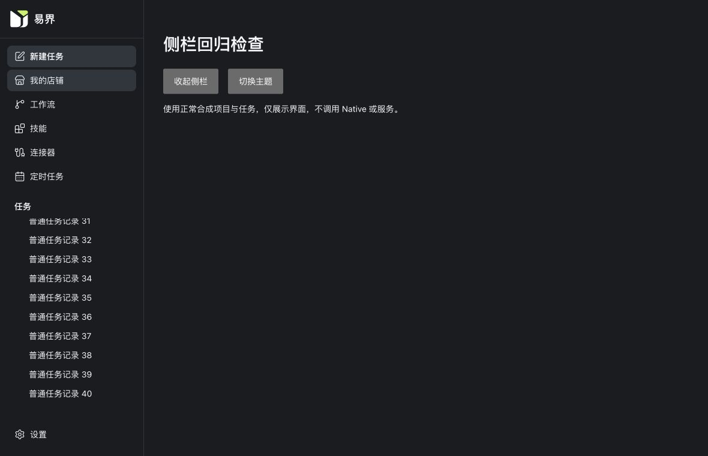

# 2026-11-02 前端与 Native 全量回归修复

本轮承接目录生成修复后的 32 项前端、29 项 Rust 失败。逐项分类见 [失败项与根因映射](evidence/2026-11-02-full-regression-repair/failure-classification.json)。原始失败基线仍保留在 [上一轮审计](2026-11-02-catalog-generation.md)，没有覆写成通过结果。

## 真实功能修复

1. **侧边栏折叠失效。** `ChatSidebarTree` 已含 Teleport 和 section 多个根节点；Vue 不能把组件上的 `v-show` 应用到实际树容器。`YjSidebar` 改用现有组件外的真实 flex 容器承接显示状态，保留 `min-height: 0` 的滚动约束，树组件继续挂载。原折叠回归通过，并在 1180×760 的亮色、暗色预览中使用 40 条普通任务验证：324px 高的滚动区可滚到第 40 条，折叠隐藏，恢复后 1012px 滚动位置不变，底部设置入口保持可见。
2. **本地失败提交仍显示排队。** 通用 `fail_outbox` 原来只更新 outbox，未同步 `chat_turns.submission_status`。复用现有 SQLCipher 事务和本地提交失败路径，共用同一更新函数，把两个本地状态原子写入。只处理同一 operation/session、尚无 Runtime turn/事件的排队请求；不改变 Runtime status、terminal time 或思考状态。补充正常关闭并重开数据库后的回归，验证失败状态保持、下一次发送可继续、没有凭空创建 Native 执行事实。

## 过期测试及校验入口修复

| 分类 | 根因与修复 |
| --- | --- |
| 20 项 Rust 传输 fixture | 当前 coordinator 已使用 events v11/native-thread v4，模拟服务仍只接受旧路径。更新当前集成 fixture 的版本、路径和头部；旧协议独立解码测试继续保留。 |
| 本地失败和不确定状态 | 旧断言把未发送请求当作模型终结，或要求对含糊的 accepted 回复重发。现验证本地失败与 Runtime 事实分离；不确定请求保留原 operation，只允许原观察恢复，不重复 POST。 |
| Markdown 格式范围 | Markdown 预览已实现，旧测试仍把它当作不支持格式。使用普通 `application/octet-stream` 数据验证真正不支持的类型，保留 Markdown 能力。 |
| Native 构建矩阵 | 新 schema 迁移原来在旧 reader 构建上运行。两项迁移验收在 Kimi writer 构建中执行；普通构建新增原样拒绝新模型存储的回滚校验。 |
| 前端 schema/模型配置 | AJV strict 模式登记现有扩展注解；候选模型测试显式装配相应开关，不修改产品默认值。 |
| UI 和帧调度 | 采用当前可访问名称、组件、图标白名单和中性状态文案。流式测试测量实际帧批次及滚动写入；初始思考 fixture 使用真实的 queued 状态，不再把同一个已完成 turn 倒置成运行中。 |
| 历史事件回放 | 测试 transport 接入现有 Native view、session purpose、Native history 查询；保留旧 live body 无效、显式历史 resync 可恢复的断言。 |
| macOS/开发资源 | 临时目录先解析 `/var` 别名；技能资源校验指向已复用的共享安装器。 |
| ECharts 校验 | 校验已批准 patch 的实际字节、workspace 与 lock 引用，再仅规范化对应两个 lock 条目。版本、registry integrity、依赖图、许可证和静态 import 校验保留；历史 scope 审计仍使用不可变提交，不再永久冻结所有后续 UI 改动。 |
| Node/Vitest 混用 | 7 个 `node:test` 文件由原 Node 测试器执行；Vue/TS 仍用 Vitest 和原 Vite transform。统一排除归档工作树，避免单文件检查同时跑旧副本。 |

扩展到日常客户端实际使用的 Kimi 构建后，另暴露 38 项测试配置问题：普通新请求 fixture 使用旧 K3 enum/schema，或启用、停用、暂停测试依赖相互冲突的进程环境。测试共用当前编译模型族和 canonical migration；历史退役 fixture 仍保存旧值。环境相关用例复用仓库已有的正常子进程隔离方式，运行当前标准构建生成的同一个测试可执行文件；先验证精确测试名确实存在，禁止“0 项运行”被误报通过。没有替换可执行文件，也没有修改运行时安全策略。

全量重跑还定位到并发观察 fixture 的跨秒问题：先保存 `now`，多次数据库操作后入队的新 turn 使用当前时间，再用旧 `now` 领取，真实的队列时效校验会返回 None。领取改用入队后的当前时钟。第二条 SSE 必须在第一条结束前接入的断言及原 2 秒连接等待均保留，没有放宽并发要求。

## 契约与兼容范围

`contract-impact = semantic`：本地持久化的失败投影行为修正，复用原 `submission_status` 字段和值。Owner/producer/consumer 均为当前 Desktop Native 与现有 UI，用户已授权修复失败项和复用已有机制。公共 API、Host wire、IPC schema 和 migrations 没有因本轮修复改变；公共契约新 pin 为 N/A。权威存储定义仍为 `src-tauri/migrations/chat/0014_chat_native_conversation.sql`，新旧模型 schema 仍由既有 migrations 和构建 feature 决定。

兼容验证覆盖普通 reader、Kimi writer、原历史、正常重开、operation 不确定状态、模型切换、定时任务和原权限边界。不把本地提交失败解释为远端完成；既有 Native 事实不被覆写。用户实际历史数据库和密钥未用于测试。

本轮没有刷新目录摘要、catalog、资格化回执或依赖锁来消除失败。目录生成相关检查继续执行。

上述 schema 与三份目录文件逐字对比当前基线 `55f88341aa59522f214c0015ed7928b8d1f5021d`，均未改变；SHA-256 和精确路径见 [权威文件核对记录](evidence/2026-11-02-full-regression-repair/unchanged-authority.json)。

## 完整验证

最终验证采用标准入口及其相同的安全过滤清单。原始日志位于 `.local/development/regression-repair-20261102/`，中间失败日志保留，不覆盖成成功。

| 检查 | 结果 |
| --- | --- |
| 前端全量（最终侧栏布局） | 249 文件、2,009 测试通过；16 skipped；0 失败。 |
| Node 原生测试 | 7 文件、26 项通过，0 失败。 |
| Kimi Native 全量 | 655 通过，0 失败，16 个原有 ignored，27 个安全 filtered。 |
| 普通 Native 全量（最终时钟修复） | 620 通过，0 失败，14 个原有 ignored，27 个安全 filtered；bin/doc 目标均正常结束。 |
| `make lint` | 通过全部生成检查、ESLint、Vue/TypeScript、Rust fmt，以及普通和 Kimi 两种 all-targets Clippy（`-D warnings`）。 |
| `make build` | 通过；仅保留既有的大 chunk 提示，无客户端安装包。 |
| `pnpm docs:build` | 通过，最终报告与证据更新后再次构建。 |

整合 `make test` 首次重跑捕获了上文的旧 fixture 时钟问题，因此该次整合命令退出码不是 0。Kimi 全量成功；修正时钟后对应 Kimi 专项再次通过，普通 Native 使用同一完整测试集合与安全清单重新执行。这里分别记录各构建的最终结果，而不把最初的失败日志改写成通过。

## 安全约束与未执行项

标准测试入口使用 [明确安全排除清单](../../scripts/test-safety-exclusions.json)，沿用上一轮审计的边界，并在输出中注明排除数量。没有以删除断言、增加 ignore 或缩小正常用例范围隐藏本轮失败。

- 未执行原有强制进程清理、替代可执行文件、权限破坏、攻击注入、危险 ZIP/PDF 等 fixture；这类场景不宣称重新验证。
- 原有 ignored、历史 S10D-H production-hardened 资格化、其他非日常 feature 和真实外部供应商调用不计入本轮通过数。
- 所有测试数据库均为普通临时数据，通过正常关闭与清理流程结束；无强杀、安装包或全量数据备份。
- 视觉检查使用生产组件与独立普通预览数据，未在真实对话中伪造消息或执行结果。预览服务正常停止。

完整结果只覆盖实际执行的非破坏性检查，不等同于生产发布或所有外部集成认证。

## 视觉证据

## 本轮缓存清理与客户端生效

完整检查正常结束后，仅删除根据创建时间确认属于本轮的新 `deps`、`.fingerprint`、`incremental` 六个目录。两份既有开发可执行文件清理前后 SHA-256 均一致，日常共享增量缓存未动。文件系统可用空间增加约 **12.96 GiB（13.92 GB）**，固定 target 回落至约 1.39 GiB。详情见 [缓存清理记录](evidence/2026-11-02-full-regression-repair/cache-cleanup.json)。

已通过原数据目录预检，从用户 Applications 中的固定“易界.app”入口完成增量启动。Native 本次增量构建耗时 14.43 秒；原 App/Host 路径运行，工作流 authenticated ready 检查通过，技能、专家和连接器目录均正常就绪（4 个已配置连接器最终 enabled=4、pending=0）。没有创建客户端安装包或全量备份，也未执行真实用户任务。启动记录见 [固定入口生效记录](evidence/2026-11-02-full-regression-repair/client-activation.json)。
